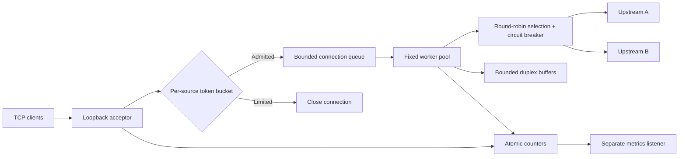

# EdgeRelay

A C++20 TCP load balancer with bounded concurrency, per-source connection admission, passive circuit breakers, and Prometheus-compatible metrics.

EdgeRelay forwards opaque byte streams. Its reliability behavior is exercised against real TCP servers: failover, recovery, backpressure, half-close handling, idle expiry, and overload rejection.

## Architecture



### Implemented behavior

- **Controlled resource use:** fixed workers, finite waiting queue, a capped source map, and two 64 KiB user-space buffers per active relay. The socket receive/send buffers and kernel listen backlog are additional resources.
- **TCP correctness:** partial reads/writes, simultaneous bidirectional traffic, byte-preserving forwarding, and propagation of write-half closures after pending data drains.
- **Passive failover:** failed connection attempts try another eligible upstream. A failure threshold opens that upstream's circuit; after cooldown one connection may probe recovery. A generation token prevents stale connection results from changing a newer circuit state.
- **Connection admission:** per-source token buckets allow bounded bursts and continuous refill. The source map refuses new entries when full unless a sufficiently idle, fully refilled entry can be reclaimed.
- **Observable outcomes:** accepted/rejected connections, queue depth, active workers, forwarded bytes, connection failures, circuit state, and idle timeouts.
- **Portable socket layer:** Winsock/select on Windows; POSIX sockets/poll on Linux.

## Build

Requirements: CMake 3.20+, a C++20 compiler, and Python 3.11+ for integration tests/benchmarks. No third-party C++ libraries or Python packages are required.

Linux with GCC or Clang:

```bash
cmake -S . -B build -DCMAKE_BUILD_TYPE=Release
cmake --build build --parallel
ctest --test-dir build --output-on-failure
python3 scripts/integration_test.py --binary ./build/edgerelay
```

Windows with Visual Studio's C++ tools:

```powershell
cmake -S . -B build
cmake --build build --config Release --parallel
ctest --test-dir build -C Release --output-on-failure
python scripts/integration_test.py --binary .\build\Release\edgerelay.exe
```

Windows with MinGW GCC and Ninja available on PATH:

```powershell
cmake -S . -B build -G Ninja -DCMAKE_CXX_COMPILER=g++ -DCMAKE_BUILD_TYPE=Release
cmake --build build --parallel
ctest --test-dir build --output-on-failure
python scripts/integration_test.py --binary .\build\edgerelay.exe
```

Use a separate build directory when changing generators/compilers. Integration tests launch temporary loopback upstreams and the compiled relay, exercise behavior, and stop those processes.

## Run

Provide your own TCP services on the two upstream ports, or use the integration suite to launch temporary echo servers automatically.

```bash
./build/edgerelay --listen-port 8080 \
  --upstreams 127.0.0.1:9001,127.0.0.1:9002 \
  --workers 8 --queue-capacity 32 --metrics-port 9090 \
  --rate 100 --burst 200 \
  --breaker-threshold 2 --breaker-cooldown-ms 1000 \
  --connect-timeout-ms 300 --idle-timeout-ms 3000
```

Use `--help` for all option bounds. Both listeners and upstreams are restricted to IPv4 loopback. Visit `http://127.0.0.1:9090/metrics` for the text exposition and `/health` for liveness. Health does not imply backend availability. The metrics listener closes each HTTP connection and bounds headers and request time.

## Testing and measured results

The policy executable contains deterministic clock-controlled tests and concurrent admission/recovery tests. The integration suite uses real sockets and validates data integrity, fairness with healthy peers, isolation between clients, half-close draining, failure/recovery, queue saturation, connection-rate refill, idle expiry, all-upstream failure, configuration rejection, and metrics deadlines.

See [VALIDATION.md](docs/VALIDATION.md) for the actual test environment and results. The [recorded loopback experiment](benchmarks/windows-loopback.json) includes every measured latency sample and a direct-backend baseline.

Reproduce a measurement:

```bash
python3 scripts/benchmark.py --binary ./build/edgerelay \
  --connections 300 --concurrency 8 --payload-bytes 4096 \
  --output benchmark-results.json
```

On Windows, use `python` and the corresponding `.exe` path. This is a closed-loop connection-and-echo benchmark that includes the Python client/server overhead. It does not isolate relay forwarding latency or establish a production throughput limit.

## Design boundaries

- Load balancing happens once per TCP connection. No HTTP routing, request retries after bytes have been forwarded, TLS termination, or application-layer authorization.
- A successful TCP connect closes a circuit. An application returning errors over a healthy connection does not trip it; there are no active health probes.
- Each active connection occupies one worker. The architecture bounds resources but does not claim event-loop scale. All clients using the same source address share one bucket.
- Token admission is charged before queue admission; a queue-rejected attempt still spends a token. The queue has a size bound but no separate waiting-age deadline.
- Connect timeout is per attempted upstream. With several unreachable peers, total setup time may include several such waits. Idle timeout resets after successful byte reads or writes.
- Shutdown stops admission and closes queued/active connections; it is not a graceful rolling drain. In-progress connect attempts can finish their configured timeout before shutdown completes.
- Metrics are approximate concurrent snapshots rather than a transactional view. They contain no payloads or credential fields.
- The loopback restriction is intentional. Public exposure, authentication, configuration reload, distributed limiter state, TLS, persistent telemetry, and application-aware health policies are outside the implemented scope.

## Source layout

| Path | Responsibility |
|---|---|
| `src/main.cpp` | Configuration, queue, workers, byte relay, metrics |
| `src/net.*` | Socket ownership and platform-specific operations |
| `include/edgerelay/policy.hpp` | Thread-safe token bucket and circuit breaker |
| `tests/policy_tests.cpp` | Policy invariants and concurrency tests |
| `scripts/integration_test.py` | Real-socket behavioral tests |
| `scripts/benchmark.py` | Baseline/relay measurement with raw samples |

Networking references: [Winsock select](https://learn.microsoft.com/en-us/windows/win32/api/winsock2/nf-winsock2-select), [Linux poll](https://man7.org/linux/man-pages/man2/poll.2.html), and [Prometheus text exposition](https://prometheus.io/docs/instrumenting/exposition_formats/).
